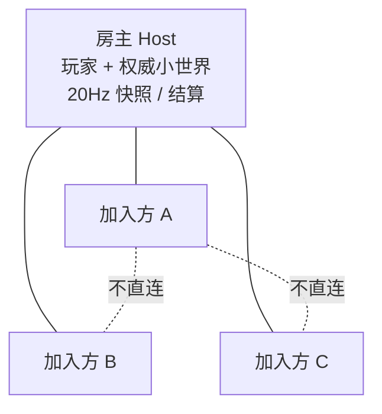
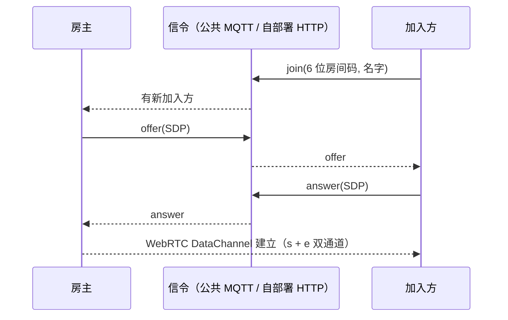

# 苍穹对决 Sky Duel

免费、免下载、**零后端**的 3D 多玩法空战游戏：浏览器打开即玩，也可以装安卓 App。
数据面是纯 WebRTC 直连，没有游戏服务器、没有账号系统、没有外部 CDN 依赖。

- 三种玩法：**空战对决** / **防空车突袭** / **直升机突袭**
- 规模：练习（打 AI）· 联机 1v1 / 3v3 / 5v5 · 五局三胜
- 平台：桌面浏览器 · 安卓 App（同一套逻辑与协议，安卓 ↔ 电脑可联机）
- 站点：<https://game.4365754.xyz>
- 当前版本：网页 **v3.10.6**（`?v=1516`）／安卓 **1.6.22**（versionCode 61）

> 本文档把原来的 `README.md` 与 `安卓版/README.md` 合并成一份，并且**先讲通信与联机架构**，
> 玩法、构建与发版放在后面。安卓版不再单独维护 README。

---

## 目录

1. [通信与联机架构（重点）](#1-通信与联机架构重点)
2. [模式包与代码结构](#2-模式包与代码结构)
3. [玩法与操作](#3-玩法与操作)
4. [跑起来](#4-跑起来)
5. [发版流程](#5-发版流程)
6. [文件职责速查](#6-文件职责速查)
7. [常见问题](#7-常见问题)
8. [许可](#8-许可)

---

## 1. 通信与联机架构（重点）

### 1.1 设计约束

| 约束 | 选择 | 代价 / 取舍 |
|---|---|---|
| 没有游戏服务器、没有账号 | 数据面纯 P2P；房主兼任权威 | 房主掉线本局结束；房主天然拥有 0 延迟优势 |
| 不依赖 STUN / TURN / 外部 CDN | `iceServers: []`，只用主机候选 | 同一 WiFi / 可直连网络最稳；跨 NAT 可能连不上 |
| 不引入构建工具 | 原生 ES Module + `?v=` 缓存号 | 所有依赖本地化，`vendor/three.module.min.js` |
| 允许 3v3 / 5v5 | **房主星型小世界**（不是全 mesh） | 房主上行压力集中；换来 O(N) 连接与单一权威 |
| 必须永远能联机 | 手动邀请码/应答码兜底 | 操作比房间码麻烦，但不依赖任何第三方 |

### 1.2 拓扑：房主星型小世界



- **只有房主和每个加入方之间有一条 WebRTC 连接**；加入方之间不互连。
- 所有上行消息先到房主，再由房主转发/广播；房主自己的消息直接广播。
- 房主不是"专用服务器"，它本身也是一个玩家；因此不做服务器级反作弊，只做**位置合理性校验**。

为什么不用全 mesh：3v3 需要 15 条连接、5v5 需要 45 条，每条都要手动 SDP 或额外信令，且没有统一裁判；
星型把连接数降到 N-1，并把血量/死亡/回合/比分集中到一处裁决。

### 1.3 连接建立：三条路



1. **房间码（默认）**：房主生成 6 位数字码，信令层 `js/signal.js` 优先走公共 MQTT WSS
   （`broker-cn.emqx.io` → `broker.emqx.io` → `hivemq` → `mosquitto` 依次探测），
   也可用 `?signal=https://你的域名/signal`（会记住到 `localStorage.sd_signal`）改走自部署 HTTP
   （`server/serve.js` 的 `/signal`，内存房间，3 分钟回收）。
2. **手动邀请码 / 应答码（永远可用）**：`js/net.js` 把 SDP 编成 `base64(JSON{type,sdp,name})`，
   双方复制粘贴即可建连；完全不经过任何服务器。
3. **练习模式**：不建立 WebRTC，本地 AI。

细节：

- `RTCPeerConnection` 的 `iceServers` 为空数组，**没有 STUN/TURN**；ICE 收集最多等 3.5 秒。
- 名字（中文安全）随邀请码/应答码一起走：`base64` 前先 `TextEncoder`，避免 `btoa` 的 Latin-1 崩溃。
- 房间码只是 6 位数字，主题是 `skyduel/<APP_KEY>/v1/<code>/...`；公共 broker 是第三方基础设施，
  SDP 里的内网 IP 会经过它。介意隐私就用自部署 HTTP 或手动码。

### 1.4 双 DataChannel

`js/net.js` 为每条连接建两条通道：

| 通道 | 参数 | 承载 | 理由 |
|---|---|---|---|
| `s`（state） | `ordered:false, maxRetransmits:0` | 20Hz 位置/血量快照、客户端 `upd`、语音包 | 实时性优先；丢一帧就丢，不阻塞后续 |
| `e`（event） | 默认可靠有序 | 大厅/选人/命中/开火/击杀/回合/比分/踢人 | 不能丢、不能乱序的状态机消息 |

`?v=` 只影响模块加载；DataChannel 消息是 JSON 文本，两边协议版本必须一致（App 与网页同版本）。

### 1.5 权威模型：客户端判定、房主裁决

```
开火者本地判定命中
   → hitRep { fid, 目标 id, 部位, 目标位置 }
   → 房主 hostSettleHit：位置校验（HIT_TOLERANCE = 40m）+ 按目标弱点表复核倍率
   → 房主扣血 / 判死 / 记台账
   → 广播 hit { 伤害, 剩余血量, 是否致命, 部位, 位置 }
   → 所有端 presentHit：特效、音效、血条、死亡表现
```

- **客户端不做本地扣血预判**：被打的一方只认房主下发的 `hp`，避免"本地先掉血、房主否决后血条回弹"。
- 40m 是留给延迟的余量：80ms 门槛 + 插值滞后，目标位置偏差通常 <25m。
- **回合/比分/比赛**由房主结算并广播 `rEnd` / `round` / `matchEnd`；非房主只跟随，不自行开新回合。
- **击杀台账** `recordAuthKill` 统一记 `k/d`，每 3 秒用 `kstat` 定向下发校正，
  自炸/自撞/误杀队友的规则见 `js/combat.js`。
- **快照**：房主 20Hz 推 `sync`（所有单位位置/朝向/血量/存活 + 比分 + 局号）；
  客户端 20Hz 推 `upd`（自己的位置/朝向/速度）。远端实体用指数插值平滑，不瞬移。
- **开火特效**：房主/客户端用 `fire` / `blt` / `fireRocket` / `rkt` 广播弹道，命中只由开火者判定；
  其他人只放特效，不参与伤害。

为什么不做"服务器权威"：项目没有服务器；如果做纯客户端权威，3v3 的血量会各说各话。
"开火者判定 + 房主校验"是零后端条件下能落地的最优折中，代价是房主仍有轻微主场优势。

### 1.6 延迟门槛与异常处理

- 连接建立后房主采样 **3 次 RTT 取最小值**；`≥ 80ms` 直接踢出（`kick` 消息 + 700ms 后断连），
  避免高延迟玩家在"客户端判定"下获得不公平命中。
- 加入方掉线：房主广播 `peerGone`，所有人清理该实体与名单；选人阶段掉线直接回大厅。
- 房主掉线：整局结束（没有迁移/重连机制），其他人收到断开提示。
- 比赛结束/重赛：房主 `matchEnd`，双方点"再来一局"发 `rematch`；不自动开新场。

### 1.7 语音

- 星型转发：非房主只把语音发给房主，房主转给其他人并本地播放；房主自己直接广播。
- 传输走 **state 通道**（不可靠、不保序、零重传），自带 `seq`；接收端 80ms 重排窗 + 抖动缓冲，
  积压超过 400ms 直接丢弃保时效。
- 采样 16kHz 单声道 Int16，40ms/包（640 采样），JSON 内 base64，约 32KB/s。
- 首次开麦会请求麦克风权限；安卓 WebView 宿主已声明 `RECORD_AUDIO` 并自动授权。

### 1.8 消息速查

| 通道 | 消息 | 方向 | 作用 |
|---|---|---|---|
| `e` | `hello` / `roster` / `team` | 双向 / 房主广播 | 握手、名单、阵营槽位 |
| `e` | `pickStart` / `pickList` / `go` / `pickCancel` | 房主 → 全员 | 选阵营状态机（表格版本化，幂等） |
| `e` | `map` / `round` / `rEnd` / `matchEnd` / `rematch` | 房主 → 全员 | 地图、局号、回合结果、整场结束、重赛 |
| `e` | `fire` / `blt` / `fireRocket` / `rkt` | 开火者 → 房主 → 全员 | 弹道特效（子弹/火箭/炸弹） |
| `e` | `hitRep` / `hitReject` / `hit` | 开火者 → 房主 → 全员 | 命中上报、校验失败、权威命中 |
| `e` | `kill` / `kstat` / `died` / `crash` / `envDmg` | 房主 / 客户端 | 播报、台账校正、死亡、碰撞、环境伤害 |
| `e` | `ping` / `pong` / `kick` | 双向 / 房主 | RTT 测量与延迟门槛 |
| `s` | `sync` | 房主 → 全员 | 20Hz 小世界快照 |
| `s` | `upd` | 加入方 → 房主 | 20Hz 自身上报 |
| `s` | `voice` | 双向（经房主） | 16kHz 语音包 |

`?debug=1` 会在 `window.__sd` 暴露调试接口（开火、状态、瞄准等），仅供自动化测试。

---

## 2. 模式包与代码结构

三种玩法**共用大厅、联机传输、渲染与主循环**；玩法内容各自放在 `js/modes/<目录>/`，
玩到才加载。**加/删模式不需要改 HTML 或大厅代码。**

```
js/
  main.js              入口：读清单 → 加载首个模式 → 渲染大厅药丸
  lobby.js             大厅外壳：只渲染，不写死任何玩法
  mode.js              读取器 + 装载器（读 js/modes.json → import 模式包）
  modes.json           ⚠ 自动生成（server/scan-modes.js），不要手改
  world/               共用世界基础设施（天空/边界/createWorld + 大厅机场）
  modes/
    air/               空战对决
      mode.json        名字 / 排序 / 主题色 / 默认地图
      index.js         游戏内容（阵营、出生点、菜单、武器、编成函数）
      net.js           联机契约（hostPrePick / groundTeam / maxSize / sync）
      maps.js          地图目录 + registerMap
      maps/            island.js / city.js
      lobby.css        本模式大厅皮肤
    aavs/              防空车突袭（同结构，maps/base.js）
    heli/              直升机突袭（同结构，maps/base.js 独立副本）
docs/
  modes.md             模式包说明
  modes-template/      新玩法模板（复制到 js/modes/<目录名> 后开工）
```

### 清单是怎么来的

浏览器不能枚举文件夹，静态站点也没有目录索引，所以：

1. `server/scan-modes.js` 扫描 `js/modes/*/mode.json`，生成 `js/modes.json`；
2. **开发**：`node server/serve.js` 每次请求清单都实时重扫 —— 加/删文件夹，刷新页面即生效；
3. **打包**：`node server/pack.js` 自动重扫，清单随 `发布/` 上线。

新增模式 = `cp -r docs/modes-template js/modes/<目录名>` → 改 `mode.json` / `index.js` / `net.js` / `maps.js`；
详细字段见 [`docs/modes.md`](docs/modes.md)。删除模式 = 删掉文件夹。

---

## 3. 玩法与操作

| 模式 | 双方 | 地图 | 核心 |
|---|---|---|---|
| 空战对决 | 飞机 vs 飞机 | 太平洋海岛 / 现代都市 | 机炮狗斗 + 机载火箭炮，弱点打击 |
| 防空车突袭 | 飞机 vs 防空车 | 军事基地 | 不对称攻防：高射机枪/火箭炮 vs 飞机 |
| 直升机突袭 | MH-6 小鸟 vs 防空车 | 军事基地 | 低空悬停、机头枪镜、航空炸弹 |

通用规则：五局三胜；撞海/撞楼/出界即毁；飞机相撞同归于尽；弱点倍率（飞机驾驶舱 ×3、发动机 ×2.5；
防空车弹药箱 ×2、炮塔 ×1.3；直升机驾驶舱 ×3、发动机 ×2、尾梁 ×1.5）；联机有友伤与误杀播报。

### 桌面

| 操作 | 按键 |
|---|---|
| 视角/瞄准 | 鼠标移动 |
| 机炮 / 主武器 | 左键 |
| 开镜 / 机头枪镜 | 右键按住 |
| 前后 / 加减速 | W / S |
| 横移 / 转车体 | A / D |
| 升降（直升机） | Q / E |
| 切武器 | 1 / 2 |
| 语音 | T（麦克风）/ Y（收听） |

### 安卓（三套键位）

安卓 App 运行同一份网页代码，触屏控件按玩法分三套，**键位互不影响**：

| 方案 | 对应模式 | 摇杆 | 加速/减速键 | 瞄准键 |
|---|---|---|---|---|
| 飞机 | 空战对决 | 上下=俯仰、左右=压坡度 | 加速 / 减速（油门） | 瞄准 |
| 防空车 | 防空车突袭 | 上下=前后挪车、左右=车体转向 | 不显示 | 瞄准 |
| 直升机 | 直升机突袭 | 上下=前后、左右=横移 | 上升 / 下降 | 枪镜 |

- 设置 →「键位布局 · 飞机/防空车/直升机」进入编辑：拖动改位置、点选后滑条改大小。
- 三套分别存 `sd_layout_plane` / `sd_layout_aagun` / `sd_layout_heli`；切玩法自动换套。
- 旧版单套 `sd_layout` 会自动迁移到飞机键位并删除旧键。

---

## 4. 跑起来

### 网页

```bash
python -m http.server 8080
# 落地页  http://127.0.0.1:8080/
# 游戏    http://127.0.0.1:8080/play/
```

必须用 http(s)（`file://` 下 ES Module 与 WebRTC 会被拦）。任意静态服务器均可，无需构建。

### 安卓

前置：Android Studio（或 JDK 17+ 与 Android SDK）。

```bash
cd 安卓版
./gradlew assembleDebug          # Windows: gradlew.bat assembleDebug
# 或双击 build-apk.bat（自动找 JDK/Gradle、编译并把 APK 复制到根目录）
```

架构：WebView + `WebViewAssetLoader`（`https://appassets.androidplatform.net/assets/...`，安全上下文），
开启 DOM storage、麦克风授权、`LOAD_NO_CACHE`、横屏沉浸式。原生只保留
`MainActivity.java`（宿主）与 `Updater.java`（启动版本校验）；旧的原生 GLES 代码已删除。

---

## 5. 发版流程

```bash
# 1) 网页：全项目 ?v= 统一 +1；改 js/config.js 的 GAME_VERSION；跑回归
# 2) 重新扫描模式清单
node server/scan-modes.js
# 3) 安卓：同步前端资源 → 重打 8 处 [ANDROID] 补丁 → 入口 ?v 与 versionCode/versionName +1
node server/sync-android.js
node server/apply-android-patches.js "vX 安卓版"
cd 安卓版 && gradle assembleDebug      # 产物复制到根目录 苍穹对决.apk
# 4) 打包静态站点（自动重扫清单、带版本 APK、version.json）
node server/pack.js                    # 生成 发布/，整体上传到 Cloudflare Pages
```

安卓端冷启动读站点根目录 `version.json` 做版本校验（低于远端会引导更新）。

---

## 6. 文件职责速查

| 文件/目录 | 职责 |
|---|---|
| `js/main.js` | 入口：读清单、加载首个模式、渲染大厅 |
| `js/mode.js` | 模式清单读取 + 按需装载 + 大厅皮肤注入 |
| `js/lobby.js` | 大厅渲染（药丸/地图/阵营）、练习与建房面板 |
| `js/state.js` / `config.js` | 共享状态（容器 const / 标量 setter）、全部可调参数 |
| `js/core.js` / `scene3d.js` | 渲染器/音频、世界重建与菜单 3D |
| `js/loop.js` | 输入（键鼠/触屏）+ 主循环 + 调试钩子 |
| `js/combat.js` | 子弹/火箭/炸弹、命中判定、伤害、回合结算、击杀台账 |
| `js/net.js` / `signal.js` | WebRTC 封装（双通道/手动 SDP）、房间码信令（MQTT/HTTP） |
| `js/netev.js` | 联机事件路由、发送层、20Hz 权威快照 |
| `js/sdp.js` | 建房/加入流程、延迟门槛、`beginMatch` |
| `js/match.js` / `pick.js` | 回合/比赛生命周期、阵营分配状态机 |
| `js/voice.js` | 语音采集、编码、转发、抖动缓冲 |
| `js/units.js` / `plane.js` / `aagun.js` / `ai.js` | 单位工厂、载具模型与物理、AI |
| `js/world/` | 天空/边界/createWorld + 大厅机场 |
| `js/modes/*` | 三个自包含模式包 |
| `docs/modes.md` | 模式包字段与新增步骤 |

---

## 7. 常见问题

**Q：为什么不用 STUN/TURN？**
为了零依赖、零账号、可离线手动建连。同一 WiFi / 可直连网络最稳；跨 NAT 失败时用同一网络或热点。

**Q：为什么房主掉线整局结束？**
没有服务器做迁移；房主是权威小世界，换主会引入状态同步与作弊面问题，当前选择直接结束。

**Q：延迟多少会被踢？**
房主采样 3 次 RTT 取最小值，≥80ms 踢出；这是"客户端判定命中"公平性的底线。

**Q：手机上打开网页为什么提示下载 App？**
网页端收窄为桌面游玩；手机浏览器会引导安装安卓版（触屏操控只在 App 内启用）。

**Q：怎么加玩法/地图？**
玩法：复制 `docs/modes-template` 到 `js/modes/<目录>`，改 `mode.json` / `index.js` / `net.js` / `maps.js`，
刷新开发服务器即可。地图：在该模式 `maps/` 下加文件并在 `maps.js` 登记。

**Q：模块为什么要带 `?v=`？**
原生 ES Module 的缓存键是完整 URL；同一模块在不同导入处必须用同一 `?v=`，否则会实例化多份、共享状态分裂。

---

## 8. 许可

本仓库暂未声明开源许可证。如需允许他人使用、修改、分发，请自行补充 `LICENSE`（例如 MIT / Apache-2.0）。
