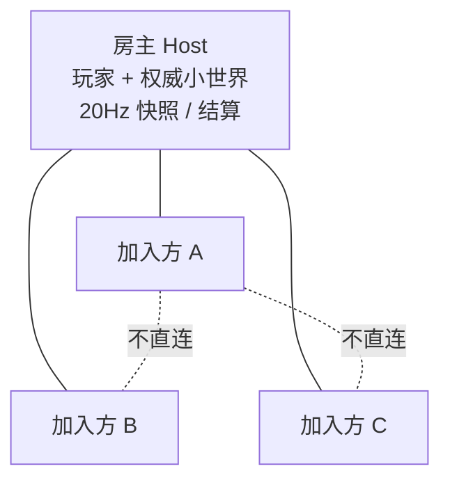
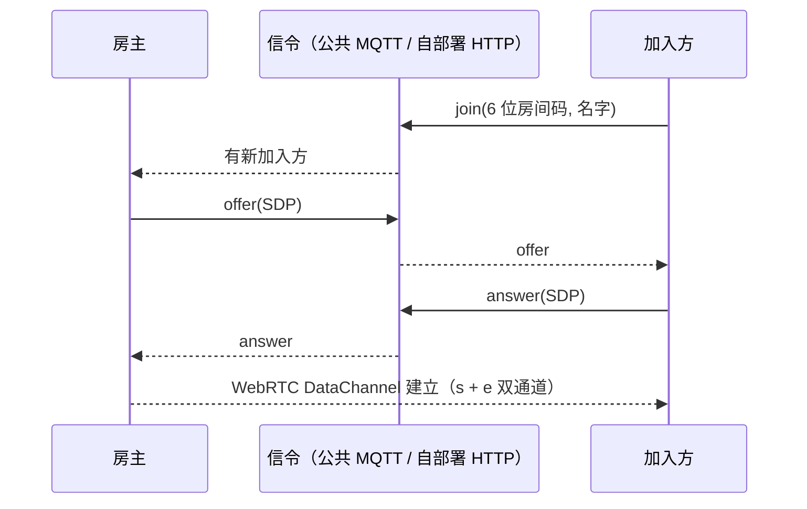

# 苍穹对决 Sky Duel

免费、免下载、**零后端**的 3D 多玩法空战游戏：浏览器打开即玩，也可以装安卓 App。
数据面是纯 WebRTC 直连，没有游戏服务器、没有账号系统、没有外部 CDN 依赖。

- 三种玩法：**空战对决** / **防空车突袭** / **直升机突袭**
- 规模：练习（打 AI）· 联机 1v1 / 3v3 / 5v5 · 五局三胜
- 平台：桌面浏览器 · 安卓 App（同一套逻辑与协议，安卓 ↔ 电脑可联机）
- 站点：<https://game.4365754.xyz>
- 当前版本：网页 **v3.19.0**（`?v=1543`）／安卓 **1.6.48**（versionCode 87）

> 本文档把原来的 `README.md` 与 `安卓版/README.md` 合并成一份，并且**先讲通信与联机架构**，
> 玩法、构建与发版放在后面。安卓版不再单独维护 README。

---

## 目录

1. [通信与联机架构（重点）](#1-通信与联机架构重点)
2. [模式包与代码结构](#2-模式包与代码结构)
3. [玩法与操作](#3-玩法与操作)
4. [跑起来](#4-跑起来)
5. [发版流程](#5-发版流程)
6. [文件职责速查](#6-文件职责速查)
7. [常见问题](#7-常见问题)
8. [许可](#8-许可)

---

## 1. 通信与联机架构（重点）

### 1.1 设计约束

| 约束 | 选择 | 代价 / 取舍 |
|---|---|---|
| 没有游戏服务器、没有账号 | 数据面纯 P2P；房主兼任权威 | 房主掉线本局结束；房主天然拥有 0 延迟优势 |
| 不依赖 STUN / TURN / 外部 CDN | `iceServers: []`，只用主机候选 | 同一 WiFi / 可直连网络最稳；跨 NAT 可能连不上 |
| 不引入构建工具 | 原生 ES Module + `?v=` 缓存号 | 所有依赖本地化，`vendor/three.module.min.js` |
| 允许 3v3 / 5v5 | **房主星型小世界**（不是全 mesh） | 房主上行压力集中；换来 O(N) 连接与单一权威 |
| 必须永远能联机 | 手动邀请码/应答码兜底 | 操作比房间码麻烦，但不依赖任何第三方 |

### 1.2 拓扑：房主星型小世界



- **只有房主和每个加入方之间有一条 WebRTC 连接**；加入方之间不互连。
- 所有上行消息先到房主，再由房主转发/广播；房主自己的消息直接广播。
- 房主不是"专用服务器"，它本身也是一个玩家；因此不做服务器级反作弊，只做**位置合理性校验**。

为什么不用全 mesh：3v3 需要 15 条连接、5v5 需要 45 条，每条都要手动 SDP 或额外信令，且没有统一裁判；
星型把连接数降到 N-1，并把血量/死亡/回合/比分集中到一处裁决。

### 1.3 连接建立：三条路



1. **房间码（默认）**：房主生成 6 位数字码，信令层 `js/signal.js` 优先走公共 MQTT WSS
   （`broker-cn.emqx.io` → `broker.emqx.io` → `hivemq` → `mosquitto` 依次探测），
   也可用 `?signal=https://你的域名/signal`（会记住到 `localStorage.sd_signal`）改走自部署 HTTP
   （`server/serve.js` 的 `/signal`，内存房间，3 分钟回收）。
2. **手动邀请码 / 应答码（永远可用）**：`js/net.js` 把 SDP 编成 `base64(JSON{type,sdp,name})`，
   双方复制粘贴即可建连；完全不经过任何服务器。
3. **练习模式**：不建立 WebRTC，本地 AI。

细节：

- `RTCPeerConnection` 的 `iceServers` 为空数组，**没有 STUN/TURN**；ICE 收集最多等 3.5 秒。
- 名字（中文安全）随邀请码/应答码一起走：`base64` 前先 `TextEncoder`，避免 `btoa` 的 Latin-1 崩溃。
- 房间码只是 6 位数字，主题是 `skyduel/<APP_KEY>/v1/<code>/...`；公共 broker 是第三方基础设施，
  SDP 里的内网 IP 会经过它。介意隐私就用自部署 HTTP 或手动码。

### 1.4 双 DataChannel

`js/net.js` 为每条连接建两条通道：

| 通道 | 参数 | 承载 | 理由 |
|---|---|---|---|
| `s`（state） | `ordered:false, maxRetransmits:0` | 20Hz 位置/血量快照、客户端 `upd`、语音包 | 实时性优先；丢一帧就丢，不阻塞后续 |
| `e`（event） | 默认可靠有序 | 大厅/选人/命中/开火/击杀/回合/比分/踢人 | 不能丢、不能乱序的状态机消息 |

`?v=` 只影响模块加载；DataChannel 消息是 JSON 文本，两边协议版本必须一致（App 与网页同版本）。

### 1.5 权威模型：客户端判定、房主裁决

```
开火者本地判定命中
   → hitRep { fid, 目标 id, 部位, 目标位置 }
   → 房主 hostSettleHit：位置校验（HIT_TOLERANCE = 40m）+ 按目标弱点表复核倍率
   → 房主扣血 / 判死 / 记台账
   → 广播 hit { 伤害, 剩余血量, 是否致命, 部位, 位置 }
   → 所有端 presentHit：特效、音效、血条、死亡表现
```

- **客户端不做本地扣血预判**：被打的一方只认房主下发的 `hp`，避免"本地先掉血、房主否决后血条回弹"。
- 40m 是留给延迟的余量：150ms 门槛 + 插值滞后，目标位置偏差通常 <30m。
- **回合/比分/比赛**由房主结算并广播 `rEnd` / `round` / `matchEnd`；非房主只跟随，不自行开新回合。
- **击杀台账** `recordAuthKill` 统一记 `k/d`，每 3 秒用 `kstat` 定向下发校正，
  自炸/自撞/误杀队友的规则见 `js/combat.js`。
- **快照**：房主 20Hz 推 `sync`（所有单位位置/朝向/血量/存活 + 比分 + 局号）；
  客户端 20Hz 推 `upd`（自己的位置/朝向/速度）。远端实体用指数插值平滑，不瞬移。
- **开火特效**：房主/客户端用 `fire` / `blt` / `fireRocket` / `rkt` 广播弹道，命中只由开火者判定；
  其他人只放特效，不参与伤害。直升机炸弹同样走 `fireRocket` / `rkt`，带 `bomb:1` 与
  `v/g/br/lr/life`（初速继承载机速度），接收端由模式包 `spawnRemoteBomb` 按同一套物理重建。
- **模式一致性**：三种玩法是三个独立模式包（实体、钩子、地图、弱点都不同），两端必须一致。
  邀请码里带房主的 `gm`，加入方在生成应答码**之前**就比对，不一致直接拒绝（不建 PeerConnection）；
  连接后 `hello` 再带一次 `gm` 兜底，不一致由房主踢出并提示双方模式名（`modeMismatch`）。

为什么不做"服务器权威"：项目没有服务器；如果做纯客户端权威，3v3 的血量会各说各话。
"开火者判定 + 房主校验"是零后端条件下能落地的最优折中，代价是房主仍有轻微主场优势。

### 1.6 延迟门槛与异常处理

- 连接建立后房主采样 **3 次 RTT 取最小值**；`≥ 150ms` 才踢（`kick` 消息 + 700ms 后断连），
  避免高延迟玩家在"客户端判定"下获得不公平命中。
- **不达标先补采一轮**：第一轮 3 次不达标不立即踢，隔 1s 再采 3 次；
  两轮都不过才判定为真实网络问题。连接刚建立时对端可能在做首帧渲染 / GC，
  pong 被主线程卡住会让 RTT 虚高，单轮判定会冤枉人。
- **延迟与渲染分离**：加入方收到 `team` 时**不建世界**，唯一建世界点是 `pickList`
  （房主必须先「人齐 + 全员延迟达标」才发得出来）。3v3/5v5 凑人途中连上的人只测延迟不建世界，
  最后一人没过测试就永远不会建世界 —— 否则 `rebuildWorld`（实测单次 120~230ms，冷启动可达 1s+）
  会把 pong 卡住，把正常玩家算成高延迟。
- **通过检测才算「就绪」**：人齐判定用的是就绪人数，不是「hello 完的人数」。
  否则最后一名玩家刚连上就开局，约 540ms 后延迟不达标被踢，房主正选到一半会被
  「有人掉线，全员回大厅」打回大厅。同时主动踢出**不缩编** —— 3v3 不会悄悄变成 2v2。
- 加入方掉线：房主广播 `peerGone`，所有人清理该实体与名单；选人阶段掉线直接回大厅
  （主动踢出例外：不动正在进行的选人流程）。
- 房主掉线：整局结束（没有迁移/重连机制），其他人收到断开提示。
- **回菜单是软重置**：返回 / 被踢 / 掉线 / 超时统一走 `js/reset.js` 的 `backToMenu()`，
  不再 `location.reload()` —— 停输入 → 关连接（`Net.close()`）→ 清实体/弹道 → 清 roster/对局状态
  → 清 UI → 重建菜单 3D。对端在 `onClose` 里各自软重置，页面不刷新、已加载的模式包不丢。
  清 UI 时**只能 `hideAllPanels()`，不能再 `showMenuBox()`**：`#menuBoxBody` 自身带 `.menuBox`
  玻璃样式，恢复显示但子面板全隐藏时会在屏幕正中留下一条空玻璃条。
- 比赛结束/重赛：房主 `matchEnd`，双方点"再来一局"发 `rematch`；不自动开新场。

### 1.7 语音

- 星型转发：非房主只把语音发给房主，房主转给其他人并本地播放；房主自己直接广播。
- 传输走 **state 通道**（不可靠、不保序、零重传），自带 `seq`；接收端 80ms 重排窗 + 抖动缓冲，
  积压超过 400ms 直接丢弃保时效。
- 采样 16kHz 单声道 Int16，40ms/包（640 采样），JSON 内 base64，约 32KB/s。
- 首次开麦会请求麦克风权限；安卓 WebView 宿主已声明 `RECORD_AUDIO` 并自动授权。

### 1.8 消息速查

| 通道 | 消息 | 方向 | 作用 |
|---|---|---|---|
| `e` | `hello` / `roster` / `team` | 双向 / 房主广播 | 握手、名单、阵营槽位 |
| `e` | `pickStart` / `pickList` / `go` / `pickCancel` | 房主 → 全员 | 选阵营状态机（表格版本化，幂等） |
| `e` | `map` / `round` / `rEnd` / `matchEnd` / `rematch` | 房主 → 全员 | 地图、局号、回合结果、整场结束、重赛 |
| `e` | `fire` / `blt` / `fireRocket` / `rkt` | 开火者 → 房主 → 全员 | 弹道特效（子弹/火箭/炸弹） |
| `e` | `hitRep` / `hitReject` / `hit` | 开火者 → 房主 → 全员 | 命中上报、校验失败、权威命中 |
| `e` | `kill` / `kstat` / `died` / `crash` / `envDmg` | 房主 / 客户端 | 播报、台账校正、死亡、碰撞、环境伤害 |
| `e` | `feed` | 房主 → 全员 | 系统播报（`kind:'left'` = 某玩家离开房间） |
| `e` | `ping` / `pong` / `kick` / `modeMismatch` | 双向 / 房主 | RTT 测量、延迟门槛、玩法不一致拒绝 |
| `s` | `sync` | 房主 → 全员 | 20Hz 小世界快照 |
| `s` | `upd` | 加入方 → 房主 | 20Hz 自身上报 |
| `s` | `voice` | 双向（经房主） | 16kHz 语音包 |

### 1.9 爆炸物与引信

| 情况 | 规则 |
|---|---|
| 火箭弹 → **敌方** | 10m 近炸（`ROCKET_PROX_R`），命中即致命 |
| 火箭弹 → **队友** | **没有近炸**，必须实碰（`ROCKET_HIT_R = 4.2m`） |
| 航空炸弹 → 任何单位（含队友） | **完全没有近炸**，实碰 5m（`BOMB_HIT_R`）；落地 / 撞障碍照旧起爆 |
| 弹药 → 子弹 / 其他弹药 | **不拦截、不互撞**：弹只能由引信、撞地、超时起爆 |
| 爆炸 → 范围内的其他弹药 | **不连锁**：爆炸不会点着别的火箭 / 炸弹 |

两条实现要点：

1. **优先判敌**：先在所有敌方目标里找近炸范围，敌方都没触发才判队友实碰。否则"队友站在旁边"
   会把敌人的近炸吞掉，玩家会以为瞄着敌人却炸了队友。
2. **只有归属者结算**：让非归属者的机器去引爆别人的弹（子弹打爆、弹药互撞、爆炸连锁），
   同一发弹就会在两台机器上各结算一次（射手算近炸、被打方算打爆），房主按「发送者 + fid」
   去重拦不住 → 双倍伤害、人头还可能算给打爆的一方。所以这些交互全部不做，
   弹药只有归属者会结算，跨端也不需要销毁别人的弹道。

### 1.10 子弹弹道：一条矢量、三条公式

子弹不是沿准星直线飞，而是带着载具速度、被空气阻力与重力同时改写的一条抛物线。

```
v(0) = dir · 880 + v_carrier         // 枪口初速 + 载具完整速度（伽利略叠加）
每帧  pos += v·dt
      v   *= 1/(1 + c·|v|·dt)        // 真实二次阻力 dv/dt = -c·v²
      v.y -= 9.8·dt                  // 重力
伤害 = 基础 × (|v_hit| / |v0|)²      // 动能 ∝ v²，下限 0.35
```

`c = BULLET_DRAG_Q = 3.6e-4 /m`，由 `½·ρ·Cd·A/m` 算出（30mm 机炮：m=0.36kg、A=7.07e-4m²、Cd≈0.30、ρ=1.225）。

**为什么是一条矢量，而不是按情形分支**：直升机前进时向下射击、后退时向前射击、飞机巡航、
防空车炮塔转侧边跑边打 —— 全部由同一个加法表达，代码里没有 `if (前进) … else if (后退) …`。
`v_carrier` 取载具此刻的完整世界速度：直升机 `fighter.vel`（前进 / 后退 + 横移 + 升降）、
飞机 `机头 × speed`、防空车 `forwardOfBody × speed`。

| 情形 | v(0) | 结果 |
|---|---|---|
| 前进 108 + 机炮垂直向下 | `(0, -880, -108)`，模长 886.6 | 带走 108 m/s 前进量，弹道朝前偏 |
| 后退 40 + 机头前射 | `(0, 0, -840)` | 弹速降到 840，方向被拉向后 |
| 前进 108 + 机头前射 | `(0, 0, -988)` | 弹速升到 988 |
| 侧飞 16 + 上升 10 + 垂直上射 | `(16, 890, 0)` | 三个分量全部保留 |
| 飞机巡航 95 | `(0, 0, -975)` | 机体速度沿机头，弹速 975 |

随机 200 组「任意发射角 × 任意载具速度」全部满足 `v(0) = dir·880 + v_carrier`（误差 0），
四种情形的实际位置与解析解偏差均 < 4m（0.6s 时）。

**三种发射角不需要任何分支**，差异全在公式的投影里：

| 发射角 | 现象 | 原因 |
|---|---|---|
| 水平 | 下坠最明显（600m 掉 2.3m） | 重力全部变成垂直偏移 |
| 向上 | 爬高越来越慢、水平射程短、几乎没有横向下坠 | 重力先吃掉速度 |
| 向下 | 更快到目标、衰减最小 | 重力与速度同向 |

垂直向上 / 向下也验证过：水平位移恒为 0（0.6s 升约 520m / 降约 520m）。

实测（975 m/s 出膛）：600m 处速度剩 **81%**、伤害剩 **65%**、下坠 **2.3m**；900m 处 72% / 52% / 5.8m。

**撞世界用线段采样**：880 m/s 一帧能走 15~50m，单点检测会直接穿楼。`bulletHitWorld()` 沿
`prev→pos` 按 ≤10m 采样，并用 `world.maxTop` 快速剔除"整段都在最高碰撞体之上"的空中弹。

#### 联机：两端必须是同一条曲线

- `blt` / `fire` 报文的 `s` 是**纯枪口初速 880**（不含载具速度），`iv` 是发射瞬间的**完整**载具速度
  （静止时省略该字段，报文长度与旧版一致）；接收端用 `dir·s + iv` 重建同一个 `v(0)`，再按同一套积分推进。
- `BULLET_INHERIT_MAX = 200` 在 `spawnBullet` 里夹紧（飞机 170 m/s 要能完整进报文，改包也造不出"拐弯子弹"）。
- 伤害系数 `df` 由射手端算好、随 `hitRep` 送给房主：`最终伤害 = 基础 × 部位倍率 × df`。
  房主端把 `df` 夹到 `0.2~1`（改包最多拿满伤害），旧客户端不带 `df` 就按 1 处理。

测试：`unified-ballistics-test.js` 13/13、`ballistics-test.js` 19/19、
`bullet-inertia-test.js` 9/9、`bullet-iv-net-test.js` 6/6、`ballistics-net-test.js` 12/12。

### 1.11 火箭弹推进：点火 → 巡航 → 无动力

燃料量固定，所以真正决定"烧多久"的是**时间**。两个时间点把飞行切成三段：

| 阶段 | 时间 | 物理 |
|---|---|---|
| 点火 | `0 → ROCKET_IGNITE_T`（1.0s） | 推力沿弹轴，速度 **从 0 加速**到 `ROCKET_V_MAX`（300 m/s），同时受重力 |
| 巡航 | `→ ROCKET_FUEL_T`（2.17s） | 燃料还在烧，推力矢量配平阻力与重力 → 速度大小与方向都维持（弹道笔直） |
| 无动力 | 燃料耗尽 → `ROCKET_LIFE`（9s） | 二次阻力减速 + 重力下坠，越飞越慢、越飞越低 |

```
ROCKET_BOOST_ACCEL = V_MAX / IGNITE_T = 300 m/s²
ROCKET_FUEL_T      = BOOST_RANGE / V_MAX + IGNITE_T / 2 = 2.17s     // 由"燃料段正好飞 500m"反解
```

水平发射时三段加起来约飞 **500m**（实测 509~513m，差值是逐帧积分的步长误差）；向上 / 向下发射的燃料段距离与水平基本一致
（±3%），只有弹道形状不同。**尾焰**只在点火与巡航两段可见（`mesh.userData.flame`），燃料一尽立刻熄灭。
航空炸弹 `fuelT = 0`，直接跳过助推段。

> **现实对照**：RPG-7 是「无后坐力炮 + 火箭增程」—— 出膛就有 117 m/s，离膛约 10m 后点火，
> 烧 1.5 秒加速到 294 m/s，之后纯惯性飞到 920m 自毁。本作按需求做成**纯火箭从零点火**，
> 并把巡航段的速度保持当成推力矢量控制（真实的**无制导**火箭在助推段也会被重力持续拉弯，
> 500m 处要抬 3° 左右）。所以这里不是"完全真实"，是"真实的重力 + 可控的助推段"。

#### 挂架：左右各 1 发

模型上每侧本来就有多管口（飞机品字 3 管、防空车 2×2 四管），取每侧上方内管作为出膛点，
顺序 **左 → 右**，共 2 发备弹（`ROCKETS_PER_AAGUN = 2`）。`fireRocket` / `firePlaneRocket`
用 `rocketSide` 轮转（`(side + 1) % 2`），新回合与重生归零。

#### 联机

远端只重建视觉弹体（`spawnRocketFx`），燃料倒计时、点火、巡航、尾焰开关全部走同一套常量，
所以两端看到的是同一段加速曲线。`rkt` 报文只带 `o`（出膛点）与 `d`（方向），不带每帧位置 ——
弹道由两端各自积分，帧率不同也不会跑偏（实测两端燃料耗尽帧速度都是 300）。

测试：`rocket-stages-test.js` 13/13（初速 0 / 点火段加速 / 巡航速度与高度维持 / 尾焰开关 /
助推距离 / 无动力减速下坠）、`ballistics-test.js` 火箭段、`ballistics-net-test.js` 远端重建。

### 1.12 声音：声波球与多普勒

**声音不再瞬时到达**。每个世界音效在声源处生成一个"球"，半径按 343 m/s 膨胀（`AudioEngine.bubbles`），
主循环每帧 `audio.update()` 检查听者是否已经碰到球面，碰到才播：

| 情况 | 表现 |
|---|---|
| 站着不动 | 1km ≈ 2.9s 后听到 |
| 迎面全速飞向声源 | 球面朝你压过来，**更早**听到（500m 外 0.5s 后就能听到） |
| 掉头飞离 | **更晚**听到，超出可听半径（枪 900m / 爆炸 4km）就丢弃 |
| 音色 / 音量 / 左右 | 全部按"碰到球面那一刻"的听者位置计算，不会过期 |

`kind` 分四种，合成参数互不干扰：`gun`（机炮 / 高射机枪）、`rocket`（火箭 / 炸弹出膛，低频轰响）、
`boom`（爆炸）、`whizz`（擦身）。远处的爆炸更闷（低通随距离下移）更轻（距离衰减），听延迟就能判断远近。

**擦身而过 + 多普勒**：别人的子弹 / 火箭掠过机身 → 一声破空声（带通噪声快速下滑），音高按径向接近速度
做多普勒，幅度用 `tanh` 夹在 ±22% 以内（真实多普勒在 900m/s 上会算出 4 倍音高，听着像 bug）。
左右方位用 `StereoPanner` 按相机右向量定位；密集弹幕有 0.11s 节流。子弹判定 16m、火箭 22m。

自己的机炮 / 受击 / 命中提示仍是**立即播放**（距离≈0，延迟它反而怪）。

**联机侧同一套**：`fire` / `blt`（子弹）、`fireRocket` / `rkt`（火箭与炸弹，走 `enemyLaunchAt`），
所以房主也听得到加入方开火、加入方之间也互相听得到。

> 在**同一台电脑开两个窗口**测声速会听到两条时间线：受害者那端在自己位置（距离≈0）立刻播，
> 射手那端才按 343m/s 延迟。两个窗口都开着声音时听到的是叠加，不是声速失效 —— 验证请静音一端或用两台设备。

### 1.13 联机身份、语音与离场播报

**名字有三层兜底**（房间码路径会丢 SDP 里的名字）：

| 来源 | 位置 | 说明 |
|---|---|---|
| `hello.name` | `netev.js`（加入方连上就发） | **主来源**：与信令 / 手动交换链路完全解耦 |
| 应答码 `name` | `net.js` → `Net.remoteName` | 兼容旧版唯一来源 |
| `join` 重发带名 | `signal.js` 的 `mq.joinName` | 公共 MQTT 是 QoS0，丢包后重发不能是空名字，否则全场「未知玩家」 |

房主名字同理：`team` 报文带 `hn`，加入方依次用 `hn` → 信令信标 `hostNameHint` → 邀请码里的名字。

**离场播报**：对局中非房主玩家断连，房主在右上角播一条「xxx 离开了房间」，并广播
`{t:'feed', kind:'left', name}` 让所有加入方同步显示（淡蓝灰，与击杀 / 坠毁区分）。
主动踢出（延迟不达标）不播。

**语音开关必须先看有没有已接通的对端**（`nets[id].connected`）。只判 `mode === 'net'` 不够 ——
点「创建房间 / 加入房间」的瞬间 `setMode('net')` 就已经执行，会在一个人都没连上时就弹麦克风授权。
没有对端只提示「还没有玩家接入房间」，不碰 `getUserMedia`。

全局 `keydown`（W/S/1/2/T/Y）在事件目标是 `input / textarea / select / contenteditable` 时直接返回，
否则在名字框里打字就会开麦或切换武器。

### 1.14 指针锁与暂停遮罩

`requestPointerLock()` 从 Chrome/Edge 111 起返回 **Promise**，在"没有用户手势 / 窗口不在前台 /
iframe 未授权 `allow="pointer-lock"`"时是**异步 reject** —— `try/catch` 抓不到。

`match.js` 的 `lockPointer()` 失败统一派发 `sd-pl-fail`，`loop.js` 分两级处置：

| 失败次数 | 处置 |
|---|---|
| 第 1 次 | 亮出「点击继续」遮罩 —— 点击本身就是用户手势，点一下就能锁上 |
| 第 2 次（点过仍失败） | 降级「按住鼠标拖动转向」，右下角提示替换为降级说明 |

`pointerlockerror` 与 Promise reject 会**同时**到达，用 400ms 去重，否则一次失败被记成两次、直接跳级。
一旦锁定成功（`pointerlockchange` 报 `locked`），`plEverLocked` 置位，之后切窗口 / 按 Esc 只走原来的暂停遮罩。

**每场开始必须清零**：`beginMatch` / `applyRematch` 派发 `sd-match-start`，`loop.js` 清
`plFallback / plEverLocked / plFailN` 并还原 `#zoomTip`。否则上一局没锁上鼠标，下一局连「点击继续」都不弹。

`#pause` 是 body 级浮层，`backToMenu()` 必须显式 `classList.add('hidden')` ——
它不在 `#hud` 里，只清 `#hud` 会留下遮罩盖住大厅菜单，而遮罩的 click 只在 `STATE.started` 时才锁鼠标，
菜单状态下点了没反应，看着就是"卡死"。

`?debug=1` 会在 `window.__sd` 暴露调试接口（开火、状态、瞄准等），仅供自动化测试。

### 1.15 死斗模式

与歼灭（五局三胜）并列的第二种**对局规则**，与玩法（空战 / 防空车 / 直升机）正交：房主建房时选，
随 `team`（首次分配阵营）和 `cfg`（改规则 / 开局前对齐）下发，字段 `mt`（`elim` / `dm`）与 `kt`（击杀目标）。

| 设计点 | 做法 | 为什么 |
|---|---|---|
| 没有回合 | `checkRoundEnd()` 在死斗直接 return；死亡只排重生，不判"全队阵亡" | 死斗里"全队都在等重生"是常态，按存活单位判负会误判 |
| 比分 | 复用 `STATE.s0/s1`：死斗时它们就是**两队总击杀**，随 20Hz `sync` 下发 | 击杀事件丢了也能被下一帧快照校正，不必新增同步通道 |
| 计分 | 只有"有效击杀"加分：自炸、误杀队友都不加 | 防止刷分 / 误伤被算成战绩 |
| 判胜 | 任一队总击杀 ≥ `kt` → `matchOver`，结算面板显示「总击杀 X : Y（先到 N 杀）」 | 房主权威，先到先判 |
| 目标调节 | 建房面板给「数字框 + 加减 + 滑杆」三件套，**1–100 任意值**；改动经 `cfg` 立即同步，滑杆拖动 150ms 合并 | 三档不够用；范围在 UI、`cfg` 接收端、判胜处三处夹紧 |
| 重生 | **房主调度**：阵亡 3 秒后选点、本地复原并广播 `respawn{id,p,y}`；加入方只应用 | 只有房主同时握有全场位置，重生点才可能避开所有敌人 |
| 重生点 | `units.js` 的 `safeSpawnPos / safeAAGunSpawn` 在候选点里挑「水平距离最近敌人最远」的 | 防蹲出生点：固定点复活＝一睁眼就和对撞 |
| 无敌时间 | **没有**（用户明确要求），重生即满血、弹药补满 | — |
| 击杀镜头 | 阵亡时 `STATE.killcam` + `spectate` 接管（死斗**禁用**自由观战）→ 相机贴近跟随击杀者，`killcam.js` 卡片显示「被谁击落 / 阵营 / 武器」+ 倒计时 | 歼灭的观战需要队友存活且可自由切换，死斗只需要一眼看清是谁、用什么打的 |
| 武器识别 | 命中部位（`火箭弹` / `航空炸弹`）→ 击杀者载具（防空车＝高射机枪）→ 溅射 / 机炮 / 撞击 / 坠毁 | 复用 `hit` 报文已有字段，不另加协议字段 |
| 重生宽限 | 重生后 1.2 秒内忽略 `sync` 里的 `al:false` | `sync` 走不可靠通道，死亡瞬间的旧快照可能晚到，否则刚复活又原地爆炸 |
| 掉线判负 | 死斗按**名单**里是否还有对手判断，不看存活单位 | 阵亡 ≠ 掉线 |

**练习模式每一条致死路径都必须先 `setLastDmgFrom` 再 `peerDie`**：机炮溅射的两条分支（近车 / 落地）
曾经漏设击杀者，`peerDie` 拿到空的 `lastDmgFrom` → 播报「练习对手 坠毁」且击杀数不涨。
防空车突袭里每发机炮都带 8m 溅射，远距离打不中直击时必然走这条路径，所以只在"离得很远"时暴露。

### 1.16 AI 的准头与弹道补偿

子弹会掉、会减速，AI 也必须自己抬枪，否则 500m 外一发都打不中（练习模式直接变沙包）。

`ai.js` 的 `dropComp(aimDist)`：飞行时间用真实二次阻力反推 `t = (e^(c·s)−1)/(c·v0)`，
再按 `½·g·t²` 换算成角度加在机头 / 炮塔俯仰上。提前量也用同一个飞行时间。

但**全额补偿会让 AI 变成弹道计算机**（防空车练习里静止靶 9.2 秒被击毁，前 2.4 秒掉 123 点）。
所以：

| 项 | 值 | 说明 |
|---|---|---|
| 下坠补偿 | **65%** | 真人算不了那么准 |
| 瞄准摆动 | `min(1, dist/500) × 6m`，低频正弦（4.0 / 5.5 / 4.5 rad/s），只影响攻击态 | 打出来的是一串有规律的偏弹，不是每帧乱跳的喷雾 |
| 对空摆动 | ×0.5 | 空战本来就难，不再额外削弱 |
| 对地射击间隔 | **0.16s**（6.25 发/秒） | 真人飞行员对地扫射是点射，不会一直按住扳机 |

**摆动必须低频**：每帧随机抖动会让弹着点摊成一团喷雾，覆盖面反而更大、更容易命中。
**幅度必须固定**：给每个 AI 随机不同摆幅会出现"有的 9 秒秒杀、有的 75 秒打不着"，现在只有相位不同。

效果（静止防空车、不还手的最坏情况）：**18.4 / 42.3 / 42.3 秒**，一轮最多掉 30~50%，
从"一轮秒杀"变成"两到四轮"，玩家有时间移动、还击、躲掩体。复现脚本 `ai-dps-test.js`
（进 aavs 练习 → 站在炮位不动 → 采样 hp 曲线直到阵亡）。

### 1.17 远端表现与权威结算的几个坑

| 问题 | 原因 | 做法 |
|---|---|---|
| 防空车玩家看远端直升机，旋翼"翻滚" | 旧代码对所有远端飞机统一 `prop.rotation.z -= dt*40`（螺旋桨绕 z），而直升机主旋翼必须绕 y | 模型自带 `propAxis / propSpeed / tailSpeed`（直升机 = y / 26 / 62），远端插值按模型给的轴转 |
| 房主自己吃到火箭 / 炸弹时"看不到爆炸" | 非房主受害者走 `presentHit`（有爆炸），房主走 `applyMeDamage` 只有受击闷响 | `hostSettleHit` 的 `tgtIsMe` 分支补上爆炸 / 溅射 / 火花与部位提示 |
| 抢人头失败时的提示 | 目标已死时房主回 `hitReject{dead:1}`，需要和"位置不符"区分 | 客户端显示「目标已被击毁 · 未造成伤害」；只有真正的位置校验失败才显示「位置校验未通过」。客户端从不预判人头，`kstat` 每 3s 台账覆盖 |
| 联机延迟与渲染分离 | 加入方如果跟着 `team` 报文重建世界，会阻塞 pong → 被误判延迟踢出 | 加入方唯一建世界点是 `pickList`，`team` 分支禁止 `rebuildWorld` |

---

## 2. 模式包与代码结构

三种玩法**共用大厅、联机传输、渲染与主循环**；玩法内容各自放在 `js/modes/<目录>/`，
玩到才加载。**加/删模式不需要改 HTML 或大厅代码。**

> **地图生成必须是确定性的**：地形/楼群/树/车/贴图噪点都是程序化生成，
> `createWorld()` 把整段构建放进 `withSeed(hashStr(map.id), …)` 窗口（`js/world/common.js`），
> 期间 `Math.random` 被换成 mulberry32 种子序列。**同一地图 id 在任何机器上都得到逐字节一致的
> 几何与 colliders** —— 否则联机两端各长一套城市（我这边有楼、你那边空着），火箭撞楼各炸各的。
> 新地图不需要任何额外处理，只要 `map.id` 稳定即可。

```
js/
  main.js              入口：读清单 → 加载首个模式 → 渲染大厅药丸
  lobby.js             大厅外壳：只渲染，不写死任何玩法
  mode.js              读取器 + 装载器（读 js/modes.json → import 模式包）
  modes.json           ⚠ 自动生成（server/scan-modes.js），不要手改
  world/               共用世界基础设施（天空/边界/createWorld + 大厅机场）
  modes/
    air/               空战对决
      mode.json        名字 / 排序 / 主题色 / 默认地图
      index.js         游戏内容（阵营、出生点、菜单、武器、编成函数）
      net.js           联机契约（hostPrePick / groundTeam / maxSize / sync）
      maps.js          地图目录 + registerMap
      maps/            island.js / city.js
      lobby.css        本模式大厅皮肤
    aavs/              防空车突袭（同结构，maps/base.js）
    heli/              直升机突袭（同结构，maps/base.js 独立副本）
docs/
  modes.md             模式包说明
  modes-template/      新玩法模板（复制到 js/modes/<目录名> 后开工）
```

### 清单是怎么来的

浏览器不能枚举文件夹，静态站点也没有目录索引，所以：

1. `server/scan-modes.js` 扫描 `js/modes/*/mode.json`，生成 `js/modes.json`；
2. **开发**：`node server/serve.js` 每次请求清单都实时重扫 —— 加/删文件夹，刷新页面即生效；
3. **打包**：`node server/pack.js` 自动重扫，清单随 `发布/` 上线。

新增模式 = `cp -r docs/modes-template js/modes/<目录名>` → 改 `mode.json` / `index.js` / `net.js` / `maps.js`；
详细字段见 [`docs/modes.md`](docs/modes.md)。删除模式 = 删掉文件夹。

---

## 3. 玩法与操作

| 模式 | 双方 | 地图 | 核心 |
|---|---|---|---|
| 空战对决 | 飞机 vs 飞机 | 太平洋海岛 / 现代都市 | 机炮狗斗 + 机载火箭炮，弱点打击 |
| 防空车突袭 | 飞机 vs 防空车 | 军事基地 | 不对称攻防：高射机枪/火箭炮 vs 飞机 |
| 直升机突袭 | MH-6 小鸟 vs 防空车 | 军事基地 | 低空悬停、机头枪镜、航空炸弹 |

通用规则：五局三胜；撞海/撞楼/出界即毁；飞机相撞同归于尽；弱点倍率（飞机驾驶舱 ×3、发动机 ×2.5；
防空车弹药箱 ×2、炮塔 ×1.3；直升机驾驶舱 ×3、发动机 ×2、尾梁 ×1.5）；联机有友伤与误杀播报。

### 对局规则（房主建房时选）

| | 歼灭（默认） | 死斗 |
|---|---|---|
| 回合 | 五局三胜，每回合一条命 | 单场连续，无回合 |
| 阵亡 | 队友还活着则自由观战；全队阵亡判负 | 3 秒后重生（**无无敌时间**），重生前只跟随击杀者 |
| 胜负 | 先赢 3 回合 | 任一队**总击杀**先到目标（建房时 **1–100 自由调节**，默认 20） |
| 阵亡镜头 | 观战队友 / 敌人，左键切换、滚轮缩放 | 只跟随击杀者 3 秒，卡片显示凶手名字、阵营、致命武器 |
| 重生位置 | 固定出生点 | 自动挑离敌人最远的候选点（防蹲点） |

### 桌面

| 操作 | 按键 |
|---|---|
| 视角/瞄准 | 鼠标移动 |
| 机炮 / 主武器 | 左键 |
| 开镜 / 机头枪镜 | 右键按住 |
| 前后 / 加减速 | W / S |
| 横移 / 转车体 | A / D |
| 升降（直升机） | Q / E |
| 切武器 | 1 / 2 |
| 语音 | T（麦克风）/ Y（收听） |

### 安卓（三套键位）

安卓 App 运行同一份网页代码，触屏控件按玩法分三套，**键位互不影响**：

| 方案 | 对应模式 | 摇杆 | 加速/减速键 | 瞄准键 |
|---|---|---|---|---|
| 飞机 | 空战对决 | 上下=俯仰、左右=压坡度 | 加速 / 减速（油门） | 瞄准 |
| 防空车 | 防空车突袭 | 上下=前后挪车、左右=车体转向 | 不显示 | 瞄准 |
| 直升机 | 直升机突袭 | 上下=前后、左右=横移 | 上升 / 下降 | 枪镜 |

- 设置 →「键位布局 · 飞机/防空车/直升机」进入编辑：拖动改位置、点选后滑条改大小。
- 三套分别存 `sd_layout_plane` / `sd_layout_aagun` / `sd_layout_heli`；切玩法自动换套。
- 旧版单套 `sd_layout` 会自动迁移到飞机键位并删除旧键。

---

## 4. 跑起来

### 网页

```bash
python -m http.server 8080
# 落地页  http://127.0.0.1:8080/
# 游戏    http://127.0.0.1:8080/play/
```

必须用 http(s)（`file://` 下 ES Module 与 WebRTC 会被拦）。任意静态服务器均可，无需构建。

### 安卓

前置：Android Studio（或 JDK 17+ 与 Android SDK）。

```bash
cd 安卓版
./gradlew assembleDebug          # Windows: gradlew.bat assembleDebug
# 或双击 build-apk.bat（自动找 JDK/Gradle、编译并把 APK 复制到根目录）
```

架构：WebView + `WebViewAssetLoader`（`https://appassets.androidplatform.net/assets/...`，安全上下文），
开启 DOM storage、麦克风授权、`LOAD_NO_CACHE`、横屏沉浸式。原生只保留
`MainActivity.java`（宿主）与 `Updater.java`（启动版本校验）；旧的原生 GLES 代码已删除。

---

## 5. 发版流程

```bash
# 1) 网页：全项目 ?v= 统一 +1；改 js/config.js 的 GAME_VERSION；跑回归
# 2) 重新扫描模式清单
node server/scan-modes.js
# 3) 安卓：同步前端资源 → 重打 8 处 [ANDROID] 补丁 → 入口 ?v 与 versionCode/versionName +1
node server/sync-android.js
node server/apply-android-patches.js "vX 安卓版"
cd 安卓版 && gradle assembleDebug      # 产物复制到根目录 苍穹对决.apk
# 4) 打包静态站点（自动重扫清单、带版本 APK、version.json）
node server/pack.js                    # 生成 发布/，整体上传到 Cloudflare Pages
```

安卓端冷启动读站点根目录 `version.json` 做版本校验（低于远端会引导更新）。

---

## 6. 文件职责速查

| 文件/目录 | 职责 |
|---|---|
| `js/main.js` | 入口：读清单、加载首个模式、渲染大厅 |
| `js/mode.js` | 模式清单读取 + 按需装载 + 大厅皮肤注入 |
| `js/lobby.js` | 大厅渲染（药丸/地图/阵营）、练习与建房面板 |
| `js/state.js` / `config.js` | 共享状态（容器 const / 标量 setter）、全部可调参数 |
| `js/core.js` / `scene3d.js` | 渲染器/音频、世界重建与菜单 3D |
| `js/loop.js` | 输入（键鼠/触屏）+ 主循环 + 调试钩子 |
| `js/combat.js` | 子弹/火箭/炸弹、命中判定、伤害、回合结算、击杀台账 |
| `js/net.js` / `signal.js` | WebRTC 封装（双通道/手动 SDP）、房间码信令（MQTT/HTTP） |
| `js/netev.js` | 联机事件路由、发送层、20Hz 权威快照 |
| `js/sdp.js` | 建房/加入流程、延迟门槛、`beginMatch` |
| `js/match.js` / `pick.js` | 回合/比赛生命周期、阵营分配状态机 |
| `js/voice.js` | 语音采集、编码、转发、抖动缓冲 |
| `js/units.js` / `plane.js` / `aagun.js` / `ai.js` | 单位工厂、载具模型与物理、AI |
| `js/world/` | 天空/边界/createWorld + 大厅机场 |
| `js/modes/*` | 三个自包含模式包 |
| `docs/modes.md` | 模式包字段与新增步骤 |

---

## 7. 常见问题

**Q：为什么不用 STUN/TURN？**
为了零依赖、零账号、可离线手动建连。同一 WiFi / 可直连网络最稳；跨 NAT 失败时用同一网络或热点。

**Q：为什么房主掉线整局结束？**
没有服务器做迁移；房主是权威小世界，换主会引入状态同步与作弊面问题，当前选择直接结束。

**Q：延迟多少会被踢？**
房主采样 3 次 RTT 取最小值，≥150ms 才踢（第一轮不达标会补采一轮）；这是"客户端判定命中"公平性的底线。

**Q：手机上打开网页为什么提示下载 App？**
网页端收窄为桌面游玩；手机浏览器会引导安装安卓版（触屏操控只在 App 内启用）。

**Q：怎么加玩法/地图？**
玩法：复制 `docs/modes-template` 到 `js/modes/<目录>`，改 `mode.json` / `index.js` / `net.js` / `maps.js`，
刷新开发服务器即可。地图：在该模式 `maps/` 下加文件并在 `maps.js` 登记。

**Q：模块为什么要带 `?v=`？**
原生 ES Module 的缓存键是完整 URL；同一模块在不同导入处必须用同一 `?v=`，否则会实例化多份、共享状态分裂。

---

## 8. 许可

本仓库暂未声明开源许可证。如需允许他人使用、修改、分发，请自行补充 `LICENSE`（例如 MIT / Apache-2.0）。
